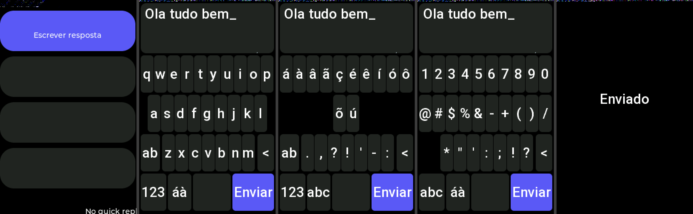

# fit3-plugin

Ferramentas e modificações não oficiais para a **Samsung Galaxy Fit3 (SM-R390)**.
Projeto independente, sem relação com a Samsung.

## Teclado de resposta (QWERTY, português)

Acrescenta a linha **"Escrever resposta"** na tela de respostas rápidas de uma notificação.
Ela abre um teclado QWERTY para responder sem pegar o celular.



*Imagens geradas no simulador do fit3-toolkit, que roda o código real do firmware. Os botões
de resposta rápida aparecem vazios e o contador `x/100` não aparece porque o simulador não tem
as fontes da Samsung. No relógio eles aparecem normalmente.*

É uma modificação do teclado do [fit3-toolkit](https://github.com/Musicalista/fit3-toolkit-fork)
(commit `2c702e4`):

- só QWERTY, sem o modo T9 e sem o botão de idioma; só o layout em português;
- sem a barra de botões no topo: o campo de texto ocupa o alto da tela;
- **Enviar** na última linha, à direita do espaço: `123` · `áà` · espaço · `Enviar`;
- teclas mais altas (70 px em vez de 50) e fonte maior (26 px em vez de 24);
- textos em português: "Escrever resposta", "Enviado", "Celular desconectado";
- não grava mais o arquivo `/user/kbd.sav` no relógio.

A tecla `áà` abre á à â ã ç é ê í ó ô õ ú. A tecla `123` abre números e símbolos.
O limite é de 100 bytes por mensagem, como no relógio original.

### Situação

| O quê | Verificado em |
|---|---|
| Firmware gerado e aprovado em todas as verificações do toolkit (73 componentes, CRCs) | PC |
| Telas do teclado (letras, acentos, símbolos, "Enviado") | simulador |
| Texto entregue ao relógio para envio, com acentos em UTF-8 (`Ola tudo bemçã`, 16 bytes) | simulador |
| Teclado original do toolkit respondendo SMS e Signal | relógio (relatado pelo toolkit, 2026-11-02) |
| Esta versão modificada num relógio real: teclado funcionando | relógio (2026-11-15) |
| Instalação pelo Fit3-App (em vez do PC com Linux) | relógio (2026-11-15) |
| Quais apps de mensagem aceitam a resposta (WhatsApp etc.) | ainda não registrado |

### ⚠️ Riscos

- Isto **modifica o firmware do relógio**. Um erro pode deixar o relógio inutilizável, e um
  relógio que não liga não se recupera por Bluetooth.
- Só funciona no firmware **`R390XXU0AZA3`**. O build recusa qualquer outro.
- O firmware gerado deixa o relógio **aceitando conexões Bluetooth sem pareamento**: qualquer
  pessoa por perto consegue ler e gravar arquivos nele. Veja a seção 4 do
  [guia do toolkit](https://github.com/Musicalista/fit3-toolkit-fork/blob/main/docs/howto.md).
- O **Relógio Mundial** da lista de apps é substituído pelo "Application Hub" do toolkit.

### Gerar o firmware

Precisa de Linux com `git`, Python 3 (`numpy`, `Pillow`), `arm-none-eabi-gcc` e a fonte Roboto.
Precisa também do firmware original `stock-aza3.bin`
(SHA-256 `25e692badec82afe111c517c19c5dbdb1d28c8558c2b027143c43f5c8d05998a`), disponível por exemplo no
[fit3-flasher](https://github.com/yuriyurin/fit3-flasher). O firmware **não** faz parte deste
repositório.

```sh
teclado/build.sh caminho/para/stock-aza3.bin R390XXU0AZA3_teclado_qwerty_pt.bin
```

O script baixa o fit3-toolkit no commit fixado, aplica `teclado/toolkit.patch` e gera o pacote.
O resultado esperado tem SHA-256 `6fd21d392d3eb4eda3848820422059d839464070bc4d2a9ea127919bbfae0e56`.

### Ver no simulador

```sh
cd build/fit3-toolkit
python3 -m venv local/venv && local/venv/bin/pip install unicorn capstone pillow numpy
mkdir -p local/re
python3 -I src/firmware/fwx.py caminho/para/R390XXU0AZA3_teclado_qwerty_pt.bin main local/re/main-reply.bin
F3_TOOLKIT=. local/venv/bin/python -I ../../teclado/tools/preview.py local/shots
```

### Instalar

Pelo Android, com o [Fit3-App](https://github.com/yuriyurin/Fit3-App):

1. Desconecte o relógio do Galaxy Wearable e conecte no Fit3-App.
2. Toque 10 vezes rápido na aba **Atividade** e abra **Firmware flasher**.
3. Escolha o arquivo e confira: `R390XXU0AZA3 → R390XXU0AZA3`, 73 componentes e o SHA-256.
4. Com a bateria acima de 50%, confirme e espere o relógio reiniciar sem mexer nele.
5. Reconecte no Galaxy Wearable. É ele que envia a resposta ao app de mensagens.

Para desfazer, instale o firmware original pelo mesmo caminho.

## Fit3-App para relógio modificado

Instalar firmware de novo depois do primeiro: [fit3app/](fit3app/README.md) (GPL-3.0).

## Barômetro como microfone

Experimento: [barometro/](barometro/README.md).

## Créditos e licença

- Teclado e ferramentas: [fit3-toolkit](https://github.com/Musicalista/fit3-toolkit-fork), Apache-2.0.
- Instalação pelo celular: [Fit3-App](https://github.com/yuriyurin/Fit3-App), GPL-3.0 (não incluído aqui).

Este repositório é distribuído sob a [Apache License 2.0](LICENSE). O firmware e as fontes da
Samsung pertencem à Samsung e não são distribuídos aqui.
