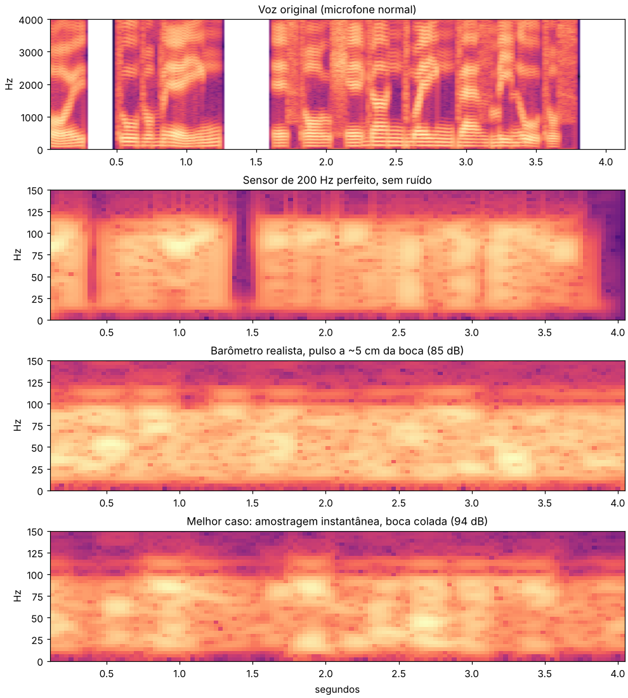

# Barômetro como microfone (prova de conceito)

Tenta usar o barômetro do Fit3 como microfone: converte leituras de pressão em áudio e filtra o
que sobra da voz. É um experimento. As contas e a simulação abaixo indicam que **não dá para
entender fala** por esse caminho. No melhor caso, dá para saber **quando** alguém está falando.

## O sensor

O firmware do processador de sensores (`/user/ota/sensorhub/sensor_hub.bin`, dentro do pacote
R390XXU0AZA3) tem drivers para três barômetros: `barometer_lps27hhtw` (ST LPS27HHTW),
`barometer_gmp108` e `barometer_mspc110`. O barômetro fica ligado a esse processador, não ao
processador principal onde roda o código do fit3-toolkit.

## Os arquivos

- `baro_mic.py`: o conversor. Recebe leituras de pressão (CSV, em hPa ou Pa) e gera um WAV de 16 kHz:
  tira a média, aplica um passa-altas de 15 Hz (remove clima, altitude e movimento do braço), um
  passa-baixas logo abaixo da metade da taxa de amostragem, uma redução de ruído espectral e, por fim,
  normaliza e converte para 16 kHz.

  ```sh
  python3 baro_mic.py leituras.csv --fs 200 -o voz.wav
  ```

- `simulate_fit3_baro.py`: passa uma gravação de voz (ou um texto sintetizado com `espeak-ng`) por um
  modelo do barômetro e depois pelo conversor. Grava os WAVs e mostra os números.

  ```sh
  python3 simulate_fit3_baro.py --text "Oi, tudo bem? Estou chegando em dez minutos." --spl 100 94 85 70 -o resultados
  python3 simulate_fit3_baro.py --wav minha_voz.wav --spl 85 -o resultados
  ```

  Precisa de `numpy`, `scipy` e, para `--text`, de `espeak-ng`.

O modelo usa valores típicos de datasheet de um barômetro de relógio, não medições de um Fit3:
200 leituras por segundo, ~0,7 Pa de ruído e resolução de 1/4096 hPa. `--avg 1` faz cada leitura ser
a média da pressão no intervalo, como acontece num sensor com média interna. `--avg 0` faz uma leitura
instantânea, em que as frequências altas se dobram para baixo em vez de sumir. Esse é o melhor caso.

## Resultado da simulação (voz sintetizada, 2026-11-15)

Só **0,25%** da energia da fala cai na faixa que um sensor de 200 Hz enxerga (até 100 Hz).

| Fala no relógio | Pressão | Com média (realista) | | Instantâneo (melhor caso) | |
|---|---|---|---|---|---|
| | | SNR no sensor | Envelope | SNR no sensor | Envelope |
| 100 dB (gritando colado) | 2 Pa | −9,9 dB | 0,16 | +7,5 dB | 0,81 |
| 94 dB (boca colada) | 1 Pa | −15,7 dB | 0,33 | +1,6 dB | 0,79 |
| 85 dB (pulso a ~5 cm da boca) | 0,36 Pa | −25,1 dB | 0,12 | −7,8 dB | 0,47 |
| 70 dB (~30 cm) | 0,06 Pa | −38,9 dB | 0,00 | −22,8 dB | 0,06 |

*SNR: potência da fala dividida pela do ruído, na faixa útil (0 dB = iguais). Envelope: correlação
entre o volume do sinal processado e o volume da fala original (1 = acompanha, 0 = não acompanha).*



Conclusão: palavras não sobrevivem. Mesmo um sensor perfeito, sem ruído, a 200 Hz só guarda um zumbido
grave sem as frequências que distinguem as vogais e consoantes. Com a boca praticamente encostada no
relógio e no melhor caso de amostragem, o volume do sinal acompanha a fala (0,8). Isso serve para
**detectar voz ou sopro**, não para transcrever.

## Etapa 1 do microfone: experimento de ODR do acelerômetro

`sensorhub/` gera um firmware igual ao teclado+sensores, mas com **um byte** mudado no processador de
sensores para o acelerômetro (ICM-42670) rodar a 1600 Hz em vez de travar em ~100 leituras/s. É um
**experimento de medição**, não o produto final: o app **Acelerometro** mostra quantas leituras
realmente chegam depois da mudança.

```sh
sensorhub/build.sh caminho/para/stock-aza3.bin R390XXU0AZA3_accel1600.bin
```

| O quê | Verificado em |
|---|---|
| 1 byte no firmware de sensores, todos os CRCs do pacote refeitos, imagem principal intacta | PC |
| Resultado no relógio (quantas leituras chegam) | **ainda não testado** |

⚠️ É o **primeiro patch no firmware do processador de sensores**. Seguro quanto à memória e só age ao
ligar o sensor (não no boot), então o relógio liga e pode ser reinstalado. Reversível reinstalando o
firmware original. Enquanto estiver instalado, o acelerômetro roda mais rápido, o que pode bagunçar
contagem de passos e detecção de queda — reinstale o original para voltar ao normal.

## No relógio: o app "Barometro"

`watch/baro.c` é um app para o Application Hub do fit3-toolkit (veja [firmware.md](firmware.md)):

- liga o barômetro pelo serviço de sensores do próprio firmware e pede o modo de 100 Hz;
- mostra a pressão, quantas leituras chegam por segundo, as duas palavras cruas do registro, uma
  onda das variações rápidas (altura total = 2 Pa) e o nível delas;
- **Gravar** guarda 1000 leituras (~10 s) em `/user/baro.bin`;
- **Modo 100 Hz / Modo 1 Hz** troca o modo;
- ao sair, volta o sensor ao modo 0 e para de ouvir.

```sh
barometro/watch/build.sh caminho/para/stock-aza3.bin R390XXU0AZA3_teclado_sensores.bin
```

Gera o firmware com o teclado e os apps **Acelerometro** e **Barometro** no Application Hub (SHA-256
esperado `3e26b9e6ebeaac25…`, impresso pelo script). O Relógio Mundial continua substituído pelo Hub.

Depois de gravar, baixe `/user/baro.bin` com o gerenciador de arquivos do Fit3-App e converta:

```sh
python3 baro_mic.py baro.bin -o voz.wav
```

O `baro_mic.py` mede a taxa real a partir da gravação, grava também um CSV e mostra os primeiros
registros crus.

| O quê | Verificado em |
|---|---|
| Endereços e formato dos dados | leitura do firmware |
| App: tela, taxa, nível, gravação, arquivo, desligamento (`watch/test_baro.py`, 12 verificações) | simulador, com leituras simuladas |
| App Acelerometro: varredura de taxas, identificação dos dois chips, passo, ruído, arquivo (`watch/test_accel.py`, 14 verificações) | simulador, com um processador de sensores simulado |
| O app num relógio real, e o que o processador de sensores realmente entrega | **ainda não testado** |

Riscos próprios deste app: ele manda o barômetro para o modo de 100 Hz e, ao sair, para o modo 0.
Se o relógio usava outro modo, ele fica assim até reiniciar. Reiniciar o relógio restaura o normal.
A gravação faz uma escrita de ~4 KB; o fit3-toolkit relata reinícios com escritas grandes e frequentes.

## O acelerômetro como microfone (condução óssea)

O barômetro chega a no máximo 100 leituras por segundo (200 com patch no processador de sensores). O
acelerômetro vai muito mais longe: o Fit3 tem um **ICM-42670** (até 1.600 leituras/s) ou um **LSM6DSO**
(até 6.666), conforme a unidade. Com o relógio encostado no rosto ou na garganta, a vibração da voz chega
pelo osso e pela pele.

`watch/accel.c` (app **Acelerometro**) é o primeiro passo: descobrir qual chip o relógio tem e até onde
ele vai pelo caminho do firmware.

- liga o acelerômetro (sensor 0) e mostra leituras por segundo, as três palavras cruas (x, y, z),
  o **menor passo** entre leituras e o **ruído** em repouso (eixo z), nas unidades cruas;
- **Testar** pede 25, 50, 100, … 6400 leituras/s (`sensor_rate`, `0x2c0f04a0`), espera 1 s e conta
  2 s em cada uma. As taxas que chegam dizem o chip: 400/800/1600 é o ICM-42670, 416/833/1666 (ou
  qualquer coisa acima de 1.600) é o LSM6DSO;
- no fim volta a pedir 25 leituras/s e salva a varredura, o passo, o ruído e 340 leituras cruas em
  `/user/accel.bin`.

"Calibrar para o máximo de sensibilidade" (menor faixa de medida, ±2 g, modo de baixo ruído e filtro
mais aberto) **não é possível pelo caminho do processador principal**: essas configurações ficam no
firmware do processador de sensores. O passo e o ruído medidos pelo app dizem qual faixa está em uso;
com o chip identificado, dá para avaliar um patch no driver dele.

## Próximos passos possíveis

- Se o relógio mostrar ~100 leituras por segundo, gravar falando com o relógio colado na boca, e também
  soprando, e comparar no `baro_mic.py`.
- Se mostrar ~1 por segundo, o modo de 100 Hz não foi aceito: investigar `sensor_rate` (`0x2c0f04a0`) ou
  o modo de registro de dados do processador de sensores (`[algo_sampling_start] ... baro:%u`,
  `[algo_samsung_control_baro] ord:%u`).
- Se a pressão aparecer como "formato ?", o registro não é um `float` em hPa: as duas palavras cruas na
  tela e os registros salvos no arquivo dizem o formato real.

Mexer no firmware do processador de sensores não está nos planos: o fit3-toolkit não modifica nem
emula esse processador, e um erro ali pode afetar a detecção de queda.
